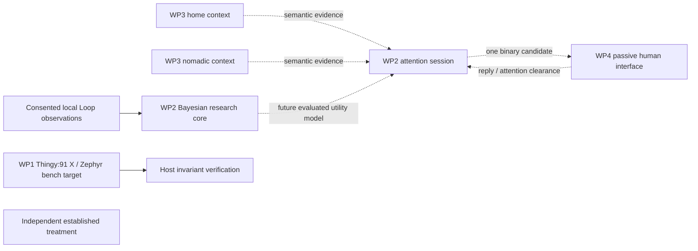

# Project LIVE — Surfer OS research

**Open-source research for people with diabetes. North star: how much human life does the system give back?**

Project LIVE develops a context-aware insulin research system that models history, actively seeks useful evidence, preserves uncertainty and reduces the attention required for diabetes management. The work is public so people can study it, contribute, adapt it and benefit from it.

**Surfer OS** is the product direction within Project LIVE: transparent context,
home/nomadic continuity and attention-budgeted human interaction. The
[updated product design](docs/SURFER_OS.md) uses the older Surfer OS specification
as inspiration and distinguishes implemented experiments from future integrations.
The repository is organized into four R&D work packages for technical review;
grant targets below are not achieved results or funding/clinical claims.

## Work packages and verification targets

| Package | Current deliverable | Proposed KPI |
| --- | --- | --- |
| [WP1: deterministic MMU bridge](wp1-deterministic-mmu-bridge/README.md) | Thingy:91 X / Zephyr C99 bench target, retained C++ host tests and vendor CAD | 0 upward violations in defined tests; <3 s measured Wi-Fi/LTE-M failover |
| [WP2: Bayesian and attention engine](wp2-bayesian-voi-engine/README.md) | Preserved consent-gated inference; EVSI, detector/session experiments; authenticated synthetic API | >80% fewer research interruptions; >85% binary response rate |
| [WP3: edge context](wp3-edge-vision-pipelines/README.md) | Metric geometry/privacy experiments and Halo/Frame interface scaffold | <12% normalized volume MAE; 0 raw-media/biometric egress bytes |
| [WP4: passive clients](wp4-passive-ui-clients/README.md) | iOS/watch SwiftUI source scaffolds | Independent synthetic setup in <30 min |



Dashed connections are synthetic/proposed integrations. There is no research-to-pump
command path. See [measurement definitions](docs/GRANT_VERIFICATION_PLAN.md),
[FMEA](docs/FMEA_SAFETY_ANALYSIS.md), [ADR 0004](docs/decisions/0004-work-package-research-monorepo.md)
and [actual validation](docs/assurance/WP_REFACTOR_VALIDATION.md).

## One-command synthetic setup

With Python 3.11+ and C99/C++17 compilers, run from the repository root:

```sh
sh tools/setup_research.sh
```

This runs the Python experiments, baseline replay and C99/C++ host checks without
downloads, device access or personal data. `PYTHON=/path/to/python3.12` selects an
interpreter. The [optional Compose/API instructions](wp2-bayesian-voi-engine/README.md)
cover FastAPI, Mosquitto and local Ollama; no VLM weights or live integrations are
preinstalled. This is not a full hardware deployment.

The merged starting point is the annotated tag `v1.0-shadow-baseline` at
`0718c94402dceefb435c2adf06db3b7faf9b02dc`. The original package moved with `git mv`
to `wp2-bayesian-voi-engine/src/project_live`; a root compatibility link preserves
the existing CLI and shared test commands.

The **Context-Aware Insulin System blueprint**, including Revision 2’s Bayesian foundation and the general-purpose virtual-sensor and Active Historical Investigation extensions, governs the design. Its explicit foundation is a Bayesian belief state: distributions over plausible hidden states and competing explanations, updated as evidence arrives. A virtual sensor is a testable question about authorized evidence, independent of hardware. Cheap detectors trigger selective deeper inference; the same planner can also retrieve and reinterpret retained historical evidence to investigate a prediction mismatch. Original online snapshots remain distinct from later retrospective understanding, and the planner can stop with uncertainty. The Codex starter contributes useful scaffolding, not the project's ambitions.

The first deliverable is a non-actuating shadow system. Current code is a synthetic research example, not a treatment system. The broad mission is to benefit people with diabetes; usefulness and suitability across different people, diabetes types, therapies and devices still require evidence.

WP1 now targets **Nordic Thingy:91 X (THINGY91X/PCA20065)** with nRF Connect SDK
3.2.1. [Build instructions](wp1-deterministic-mmu-bridge/README.md),
[vendor hashes/CAD](wp1-deterministic-mmu-bridge/hardware-vendor/MANIFEST.md) and
[ADR 0005](docs/decisions/0005-nordic-thingy91x-hardware-target.md) distinguish
source implementation from validation. Physical hardware/RF/BLE tests remain
pending hardware delivery; no real pump transport or measured failover is claimed.

## Start here

- [Full public blueprint](PROJECT_BLUEPRINT.md)
- [Project direction and open decisions](docs/PROJECT_DIRECTION.md)
- [Virtual-sensor and Bayesian architecture](docs/architecture/SYSTEM.md)
- [Proposed first synthetic slice](docs/design/SYNTHETIC_VIRTUAL_SENSOR_SLICE.md)
- [Requirements and evidence](docs/requirements/LEDGER.md)
- [Implementation backlog](docs/BACKLOG.md)
- [Contributing](CONTRIBUTING.md)
- [Governance](GOVERNANCE.md), [code of conduct](CODE_OF_CONDUCT.md) and [security reporting](SECURITY.md)
- [Engineering methodology](docs/METHODOLOGY.md), [architectural decisions](docs/decisions/README.md) and [modularity principles](docs/architecture/PRINCIPLES.md)
- [Agent operating rules](AGENTS.md) and [verified security baseline / administrator checklist](docs/security/BASELINE.md)
- [Source provenance](docs/SOURCE_MANIFEST.json), [pinned upstream baseline](docs/UPSTREAM_BASELINE.json), and [setup evidence](docs/SETUP_STATUS.md)

The public blueprint retains the technical specification with personal history omitted. Original supplied documents remain in an ignored local archive.

## Preserved Bayesian research core

The Python starter handles synthetic events, environment expiry, illustrative meal-context inference, deterministic replay and denial of all pump actions. Its hand-selected likelihood ratios do **not** implement the full specified Bayesian state estimator or virtual-sensor framework. The separate WP2 experiments do not establish clinical calibration, live sensing, a physiological controller or a deployed prompting product.

The first [LIVE-022 beverage increment](docs/assurance/LIVE022_INCREMENT.md) adds a separate executable, 27-state synthetic Bayesian example: door/audio detection, one permission-checked mock image query, scale evidence and immutable online snapshots. It uses declared toy likelihoods and a small ambiguity heuristic, with no live inputs or treatment output. Historical investigation and the full LIVE-022 milestone remain incomplete.

With Python 3.11 or later:

```sh
python3 -m unittest discover -s tests -v
python3 -m project_live.cli replay data/synthetic_example.jsonl
python3 -m project_live.cli beverage data/synthetic_beverage_v1.json
```

CI runs the baseline on Python 3.11 and 3.12. Tests need no medical devices or personal records.

See the [CI and assurance review](docs/assurance/CI_REVIEW.md) for automated gates, [executed verification evidence](docs/assurance/CI_VALIDATION.md), and the separate [administrator checklist](docs/security/CI_ADMIN_CHECKLIST.md). Passing checks remain bounded synthetic evidence.

## Repositories and contributions

- [Project LIVE](https://github.com/thebookoftheway3/project-live): public design, sensing, shadow evaluation and synthetic tests.
- [LoopWorkspace fork](https://github.com/thebookoftheway3/LoopWorkspace): upstream build workspace and pinned components.
- [Loop fork](https://github.com/thebookoftheway3/Loop): upstream application source for reviewed modifications.

Contributions in modelling, accessibility, human factors, sensor integration, testing and documentation are welcome. Discuss substantial changes in an issue and submit focused PRs with reproducible evidence. Share synthetic examples rather than personal health records. No signing or deployment workflows are enabled in the Loop forks during research setup.

## License and data

The preserved foundation is [MIT](LICENSE). New source files marked AGPL-3.0-only
use [AGPLv3](LICENSE-AGPLv3), with a possible separately negotiated OEM option; see
[exact licensing scope](LICENSE-COMMERCIAL.md). Existing MIT rights remain intact.
Separate upstream projects/assets retain their licences; see
[third-party provenance](THIRD_PARTY_NOTICES.md).

Open source means shared software and methods. Health records, raw recordings, identifiers, credentials and signing material stay outside version control. The initial research runtime cannot command a pump.

Engineering methodology and evidence: [safety methodology transfer assessment and evidence traceability](docs/assurance/TRANSFER_ASSESSMENT.md). This assessment does not establish clinical validation or authorize actuation.

Run the next bounded historical increment with `python3 -m project_live.cli history data/synthetic_history_v1.json`. It preserves online snapshots and emits a separate retrospective view; [executed evidence and remaining gaps](docs/assurance/LIVE022_HISTORY.md).

The [Loop G6 research interface](docs/assurance/LOOP_G6_INTERFACE.md) provides a consent-gated local consumer for versioned observations from the restricted Loop fork. Run its synthetic fixture before any private observations; it has no pump or network interface.
