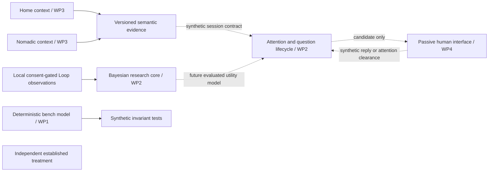

# Surfer OS within Project LIVE

Product design revision: 2026-11-16. **Research implementation, not a treatment
system or a released operating system.** Surfer OS is the product direction within
Project LIVE: transparent context, continuity between environments, and fewer
unnecessary demands on human attention. Project LIVE remains the open research
and engineering home; this is not a new repository or a replacement mission.

The older supplied Surfer OS document is inspiration, not a current implementation
contract. This updated public derivative omits personal treatment details and
separates useful ideas from unverified claims and illustrative code. The newer
WP refactoring request governs repository organization. Original documents remain
unchanged outside Git; [source manifest](SOURCE_MANIFEST.json) records their hashes.

## Product principles

1. Return attention while preserving human understanding, correction and agency.
2. Maintain one Bayesian belief architecture, with original observations,
   uncertainty, provenance and later interpretations kept distinct.
3. Let home and nomadic sources offer the same semantic evidence without pretending
   they have equal accuracy, coverage, permissions or hardware capabilities.
4. Ask one useful binary question at a time. Silence, ambiguity and no reply remain
   unknown; a model confidence score does not certify an answer.
5. Keep deterministic constraints independent of probabilistic model outputs.
   In this implementation, all interlock outputs are simulated and cannot actuate.
6. Keep raw media and biometrics local by default. A privately owned VPS is still
   a separate data destination. Local processing does not waive bystander consent.
7. Treat missing connectivity as missing evidence. Never create retrospective
   corrections that alter an earlier prediction or imply an unobserved delivery.

## Logical layers and work packages

| Surfer OS responsibility | Work package | Current state |
| --- | --- | --- |
| Deterministic constraints, timing and delivery-history accounting | WP1 | Host C++ simulation; real radio/pump transport absent |
| Multi-temporal inference, evidence acquisition and attention policy | WP2 | Baseline inference and consent-gated G6 consumer preserved; separate synthetic attention/session experiments |
| Home perception and nomadic context | WP3 | Geometry/privacy experiments; model/device integrations remain open |
| Human observation, preemption and binary feedback | WP4 | Passive SwiftUI source scaffolds; no installable app or delivery transport |

Solid connections describe logical data responsibility, not a deployed network.
Dashed edges remain synthetic or proposed. Independent treatment has no incoming
edge from this research system. WP1 is not wired to the API or the inference core.

## Current executable product slice

The existing `project_live` CLI retains its synthetic replay, Bayesian beverage
example, historical investigation and consent-gated read-only Loop G6 consumer.
It is unchanged by the relocation. The G6 consumer is not silently generalized to G7.

`surfer_session.py` implements a separate deterministic, in-memory experiment:
home and nomadic sources share a bounded semantic envelope, explicit subject,
source, evidence identity, observation time and availability time. No implicit
SELF identification, arbitrary media payload, dose or physiological conclusion is
accepted. Duplicate event IDs are idempotent; conflicting contents fail. Shared
evidence cannot earn a second question merely by changing source.

Its illustrative policy permits one pending question, a 180-second response window,
a 25-minute cooldown and at most three candidates per rolling day. These values
are configurable research choices inspired by the older document, **not adopted
clinical thresholds or validated human-factors settings**. EVSI comes from an
explicit finite decision model, compared with attention cost in the same units.
The existing Bayesian core does not yet supply a calibrated EVSI model.

Timeout records unknown and raises an experimental attention-cost multiplier;
it does not label the person inattentive, diagnose high cognitive load, or turn a
missing reply into No. A received answer is a human annotation, not guaranteed
truth or automatic collapse of the full posterior. Manual attention clearance is
bounded to 1–180 minutes in the synthetic API, with 90 minutes available as an
example. It is **distinct from WP1's 15-minute interlock lockout** and never mutes
established medical alarms or changes treatment.

FastAPI exposes authenticated synthetic `/v1/events/context`, `/v1/feedback/1bit`,
`/v1/preemptions`, `/v1/status` and `/v1/voice/callbacks` contracts. Timeline fields
in this harness are seconds from the synthetic session's origin, not wall-clock
clinical timestamps. Events/callbacks stay in memory; no outbound call is made.
The private Loop importer has no HTTP upload route.

## Retained ambitions and unresolved choices

| Older proposal | Updated interpretation / next evidence |
| --- | --- |
| Swift MMU in Loop versus dedicated C++ bridge | Keep the requested WP1 C++ bench model; final hardware/Swift placement requires an independent control architecture decision. WP4 stays passive. |
| “Stateless” MMU with watchdog and hysteresis | Pure calculation over explicit temporal state; independent state ownership and restart behavior remain hardware work. |
| Zero upward actuation guarantees safety | Narrow candidate invariant only. Downward changes, bad schedules and missing delivery can also cause harm; no safety guarantee follows. |
| 55% basal floor prevents DKA | Unvalidated research parameter; ledger accounting cannot establish physiological protection or delivery. |
| G7 warmup / compression logic suppresses alarms | Preserve quality hypotheses only. No automatic alarm suppression, basal pause or clinical threshold is implemented. Motion-present versus motion-absent examples conflict and require a measured detector model. |
| Home raw media local; mobile images uploaded to VPS | Local-only default. A future image-transfer route needs explicit destination/purpose/retention consent and separate implementation review. |
| A shared Halo/Frame SDK and bone-conduction capability | Separate device capability matrices and real SDK verification; no fabricated common driver. |
| Face-ID / SELF inheritance | Preserve uncertain subject identity; no biometric identification model included. Evaluate consent and multi-person errors before deployment. |
| Relative depth plus fixed scale yields accurate food volume | Require independent metric calibration and held-out volume references; no fixed arbitrary depth scale. Food composition and absorption remain separate unknowns. |
| Entropy × urgency called VOI | Keep as a possible heuristic comparator; implemented EVSI is expected decision-utility improvement, not entropy alone. |
| Voice AI uses rotating/spoofed contacts | No deceptive caller identity. Any future opt-in service needs a recognizable caller, agreed escalation ladder, cancellation and human-factors review. |
| Fast/mid/slow physiological loops | Preserve one owner for belief state and chronological evaluation. IOB, absorption and adaptive physiology are not implemented by the session harness. |
| 48-hour shadow run or 15-minute setup establishes readiness | Neither is sufficient evidence. Use the predeclared verification plan and record failures, missing expertise and scope limitations. |

The [grant verification plan](GRANT_VERIFICATION_PLAN.md),
[FMEA](FMEA_SAFETY_ANALYSIS.md), [ADR 0004](decisions/0004-work-package-research-monorepo.md)
and [executed evidence](assurance/WP_REFACTOR_VALIDATION.md) define the next review.
No grant eligibility, regulatory classification, independent certification or
exclusive IP ownership follows from this product description.
