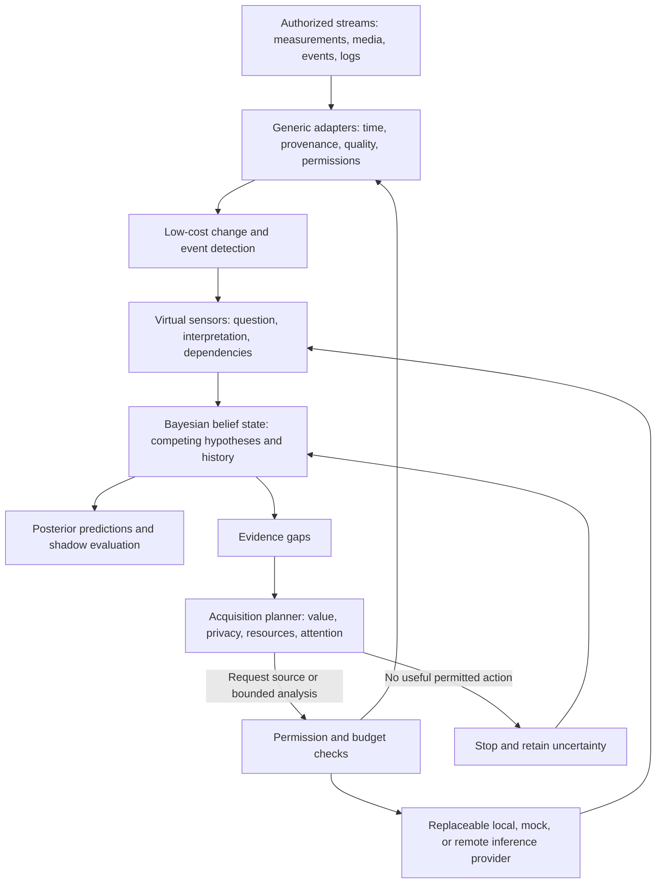

# Virtual sensors and progressive Bayesian inference

Design integration revision 3: the existing Bayesian blueprint plus the general-purpose virtual-sensor addendum. This is a logical, in-process-first design. Current code still implements only synthetic replay and illustrative meal inference.

**The sensor is the question, not the hardware.** Authorized numerical, time-series, image, audio, event and log streams are potential evidence sources. Reusable sensing infrastructure is independent of the diabetes-specific physiological model. Other applications are possible reuse, not new product commitments.

## Architecture

There is no edge to treatment actuation. The initial slice runs in one process with fixtures, a small static registry and a replay log. No service mesh, plugin marketplace or live integration is required.

## Responsibilities and boundaries

| Component | Responsibility | Must not do |
| --- | --- | --- |
| Generic source adapter | Describe authorized capabilities; produce timestamped, quality-labelled evidence and explicit availability | Turn missing samples into negative observations or bypass consent |
| Cheap detector | Trigger a question from a threshold, change or small local classifier | Treat its trigger as confirmation of a meal or diagnosis |
| Virtual sensor | Answer a versioned question with traceable evidence, alternatives and defined score semantics | Overwrite raw observations or assert an independent authoritative state |
| Provider adapter | Evaluate a bounded selected input using local processing, mock behavior or an optional external model | Execute proposed actions, accept unsupported modalities or imply calibration |
| Bayesian estimator | Own the joint belief, likelihood interpretation, state propagation, posterior updates and model-fit checks | Treat provider posterior scores as observation likelihoods without a documented model |
| Acquisition planner and scheduler | Rank eligible questions, samples and model tiers; enforce budgets, stopping and cancellation | Equate more samples with more information or treat attention as free |
| Audit/replay | Preserve evidence cutoff, lineage, policy/model versions, decisions, outcomes and costs | Rewrite earlier predictions using later evidence |

Raw observations, inferred events, hypotheses, latent state, confirmed real actions, predictions, shadow decisions and observed outcomes remain separate object classes. A shadow recommendation never enters confirmed action history without an independent real-action record.

## Composition and temporal evidence

A virtual sensor can consume raw observations or another sensor's derived evidence. Retain the full derivation graph, raw leaf IDs, time windows, sensor/model versions and known correlation groups. Reject cycles. Graph edges express derivation, not proof of statistical independence.

A combined beverage event must not enter the belief update as fresh independent evidence alongside the same audio/image leaves. Choose one documented joint observation model or replace/supersede the earlier factor during a traceable replay. Exact duplicate IDs are idempotent; distinct but overlapping samples require dependence handling. If dependence cannot be modelled, conservatively cap or withhold the increment and record why.

Repeated video frames, cross-modal views of one event, shared CGM errors and questions answered from the same input may be correlated. Missing data, timeout and refusal are availability outcomes, not evidence that an event did not happen. Negative detection only becomes negative evidence when a validated detection/coverage model supports that interpretation.

Late observations may revise the current belief through a versioned replay but never mutate the evidence cutoff or score of a previously issued forecast. A hierarchy can retain regular/diet, handled-only, different-person and unrelated-event interpretations without flattening them into a fact.

## Progressive acquisition

1. Process an authorized sample with the cheapest suitable detector.
2. Publish a virtual-sensor result and update the same Bayesian belief state.
3. Identify an uncertainty relevant to a current prediction or question.
4. Enumerate available samples, modalities, cached evidence and model tiers. Human clarification remains an optional design decision.
5. Check purpose-specific permission, destination, freshness, deadlines and hard resource limits before estimating value. An accessible source is not automatically authorized.
6. Rank permitted candidates by expected question-relevant benefit against latency, compute, API, battery, bandwidth, privacy and attention costs. Unknown cost or information value must be labelled, not invented as zero.
7. Execute only a worthwhile candidate, record its outcome and update the belief. Recheck consent before transmission and acceptance; suppress late/cancelled results as configured.
8. Stop at the deadline, budget, unavailable sources, revoked permission or lack of positive expected benefit. Return unresolved hypotheses and the stop reason.

Keep predicted information gain separate from observed entropy change and independently evaluated predictive improvement. A narrow but wrong posterior is not a successful acquisition. Include permissions and available-action sets in the audit so selection-induced missingness is visible. Prefer reuse of already-authorized cached evidence before costly reacquisition where valid.

Start with a deterministic, versioned cost/value heuristic and simulated costs. It is not an optimal information-gain policy. Budget units, tradeoff weights and escalation thresholds remain engineering decisions. No autonomous source discovery, purchases, recording activation or external upload is implied by this design.

## Bayesian continuity

Maintain `p(x_t, m_t | y_1:t, u_1:t-1)`. Preserve dependencies and multimodality, documented priors, process transitions, source likelihoods and identifiability limits. Keep slow parameters, changing state and change-point hypotheses distinct. Shared model code must not embed one person's physiology.

The existing BeliefSnapshot requirement remains: `inferred_at`, `evidence_cutoff`, `model_version`, source freshness/quality/provenance, posterior summaries and intervals, hypothesis probabilities, predictive distributions by horizon, supporting/contradictory evidence, mismatch/OOD/calibration status, evidence gaps, `shadow_only: true` and `may_actuate_insulin: false`. Extend evidence references with derivation IDs rather than introducing a competing belief API. The first context-only slice explicitly marks physiological forecasts unavailable.

## Contracts, first slice and evaluation

- [Small proposed contracts](VIRTUAL_SENSOR_CONTRACTS.md) separate source, question, provider and acquisition responsibilities.
- [First synthetic slice](../design/SYNTHETIC_VIRTUAL_SENSOR_SLICE.md) specifies the end-to-end example, alternatives and acceptance gates.
- [Decisions provider research](../research/DECISIONS_API.md) records verified capabilities and unresolved integration work.
- [Decision register](../PROJECT_DIRECTION.md#unresolved-engineering-decisions) preserves choices not yet made.

Compare cheap-only, fixed/escalate-every-time and progressive acquisition on identical held-out synthetic cases. Measure classification accuracy, precision/recall, calibration, false confidence, latency, observed information changes, downstream prediction quality, provider calls, resources and interruptions. Resource figures from mocks are labelled simulated. Preserve negative results; demonstrate marginal sensor value before adopting complexity.

The research pipeline produces no executable dosing commands and cannot modify treatment settings. Its failure does not affect the independently operating treatment system.
