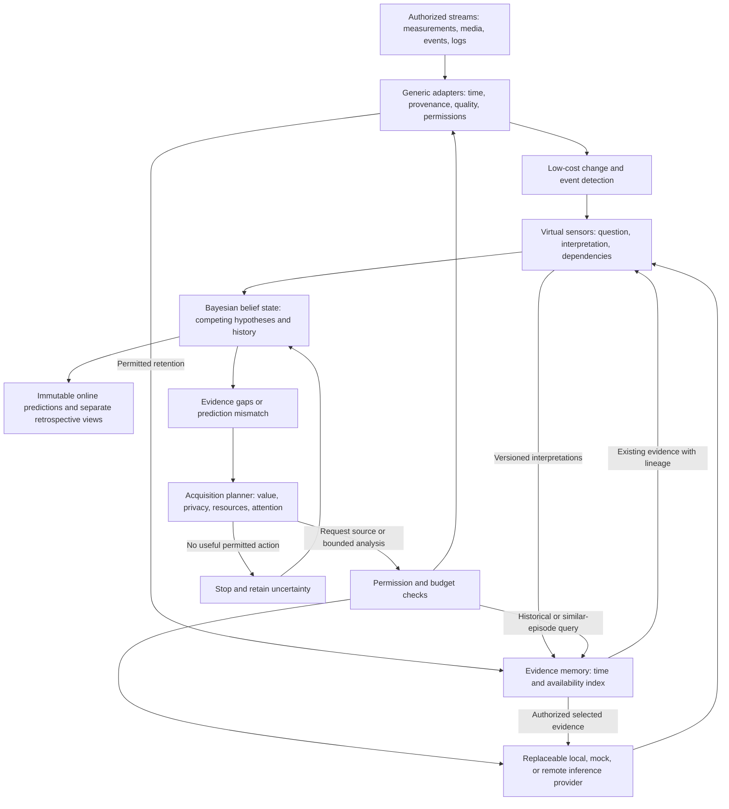

# Virtual sensors, progressive Bayesian inference and historical investigation

Design integration revision 3: the existing Bayesian blueprint, virtual-sensor addendum and Active Historical Investigation extension in the same unmerged PR. This is a logical, in-process-first design. Current code still implements only synthetic replay and illustrative meal inference.

**The sensor is the question, not the hardware.** Authorized numerical, time-series, image, audio, event and log streams are potential evidence sources. Reusable sensing infrastructure is independent of the diabetes-specific physiological model. Other applications are possible reuse, not new product commitments.

**The next useful question may concern the present, the future or the past.** Investigating why a prediction was wrong is foundational. The same planner can revisit a previously uninteresting observation or run a newly invented virtual sensor on compatible retained data. A future-oriented question concerns a prediction using available evidence, never access to future observations.

## Architecture

There is no edge to treatment actuation. The initial slice runs in one process with fixtures, a small static registry, an in-memory evidence index and a replay log. Evidence memory is a read/index view of the same envelopes and interpretations, not an independent inference subsystem. No service mesh, large database, plugin marketplace or live integration is required.

## Responsibilities and boundaries

| Component | Responsibility | Must not do |
| --- | --- | --- |
| Generic source adapter | Describe authorized capabilities; produce timestamped, quality-labelled evidence and explicit availability | Turn missing samples into negative observations or bypass consent |
| Cheap detector | Trigger a question from a threshold, change or small local classifier | Treat its trigger as confirmation of a meal or diagnosis |
| Virtual sensor | Answer a versioned question with traceable evidence, alternatives and defined score semantics | Overwrite raw observations or assert an independent authoritative state |
| Provider adapter | Evaluate a bounded selected input using local processing, mock behavior or an optional external model | Execute proposed actions, accept unsupported modalities or imply calibration |
| Bayesian estimator | Own online filtering, retrospective smoothing, joint belief updates and model-fit checks | Rewrite original online estimates or treat provider scores as likelihoods without an evidence model |
| Acquisition planner and scheduler | Rank fresh samples, retained-data analysis, historical queries, episode search and backfills together; enforce budgets and cancellation | Treat historical search as free, equate more samples with more information or treat attention as free |
| Evidence memory | Index retained evidence by target/recording time, availability and source; expose permitted query coverage and lineage | Assume indefinite raw storage, expose denied records or make a new interpretation available in the past |
| Audit/replay | Preserve evidence cutoff, lineage, policy/model versions, decisions, outcomes and costs | Rewrite earlier predictions using later evidence |

Raw observations, inferred events, hypotheses, latent state, confirmed real actions, predictions, shadow decisions and observed outcomes remain separate object classes. A shadow recommendation never enters confirmed action history without an independent real-action record.

## Composition and temporal evidence

A virtual sensor can consume raw observations or another sensor's derived evidence. Retain the full derivation graph, raw leaf IDs, time windows, sensor/model versions and known correlation groups. Reject cycles. Graph edges express derivation, not proof of statistical independence.

A combined beverage event must not enter the belief update as fresh independent evidence alongside the same audio/image leaves. Choose one documented joint observation model or replace/supersede the earlier factor during a traceable replay. Exact duplicate IDs are idempotent; distinct but overlapping samples require dependence handling. If dependence cannot be modelled, conservatively cap or withhold the increment and record why.

Repeated video frames, cross-modal views of one event, shared CGM errors and questions answered from the same input may be correlated. Missing data, timeout and refusal are availability outcomes, not evidence that an event did not happen. Negative detection only becomes negative evidence when a validated detection/coverage model supports that interpretation.

Late observations may revise the current belief through a versioned replay but never mutate the evidence cutoff or score of a previously issued forecast. A hierarchy can retain regular/diet, handled-only, different-person and unrelated-event interpretations without flattening them into a fact.

## Online filtering versus retrospective smoothing

Use two time axes: the time a state/event concerns and the time information actually became available. Let `A_tau` be the explicitly admitted evidence/interpretations whose availability is at or before cutoff `tau`, and `U_tau` the independently confirmed actions admitted by then. The manifests, rather than an event-time-only slice of a database, define these sets.

- **Online filtering:** estimate the current state `p(x_tau, m_tau | A_tau, U_tau, model_version)` using what was actually known then, allowing for delayed/missing observations in the observation model. Freeze the issued snapshot and any forward forecast with its cutoff and versions.
- **Retrospective smoothing:** later estimate an earlier state `p(x_s, m_s | A_tau, U_tau, model_version)` for `s < tau`. Later measurements and newly available interpretations can revise the earlier-state distribution. This is a new retrospective snapshot linked to the original, never a replacement for it.
- **Reanalysis with new methods:** when a model or virtual sensor registered tomorrow interprets yesterday's recordings, record a new run and version lineage. Changed assumptions as well as evidence may explain a difference; do not label that result as what the original model predicted.

Later confirmed actions remain time-stamped at their actual occurrence. A smoother's joint trajectory/transition model must not shift a later intervention into an earlier causal interval. These expressions describe the temporal views, not a commitment to a particular smoothing algorithm.

The same estimator may propagate a revised earlier-state distribution into a newly issued current belief. Preserve original online, smoothed historical and revised current snapshots separately. Evaluate original forecasts against their original cutoffs; evaluate retrospective explanation quality in a separately labelled analysis. A plausible retrospective explanation is not causal proof and does not reveal the outcome of an unperformed insulin intervention.

## Historical questions and retained evidence

A 14:30 prediction mismatch can make an unremarkable 12:30 kitchen event relevant. The planner compares a fresh sample, targeted retrieval, deeper analysis of retained observations, similar-episode search, retrospective execution of a compatible sensor and no action under the same policy. Retrieving an episode nominates evidence; similarity does not confirm its explanation or create an independent observation.

Begin with indexed synthetic envelopes and a small episode-reference table. Query bounded event/recording windows and an explicit `knowledge_as_of` boundary. Include low-interest detector records if they remain retained; do not assume they were discarded or that their media were preserved. New sensor questions can use only compatible retained representations and currently authorized purposes. Metadata-only retention cannot support a later image classifier that needs pixels.

Apply current consent/retention to index results, payloads, provider dispatch and output retention, including other people in recordings. A historical query cannot revive expired media or prior consent. Keep results/metadata only as permitted and expose incomplete-history status without disclosing denied contents. No additional retention or indiscriminate household recording follows from potential future usefulness.

As-was replay excludes later interpretations, later-trained model versions and later-available episode features/rankings. A backdated event timestamp never defeats the availability cutoff. Retrospective replay may use later evidence but advertises its new cutoff. Reinterpreted results, a triggering glucose mismatch and shared raw leaves are jointly modelled or conservatively reconciled, never counted twice because they arrived through a historical path.

## Progressive acquisition

1. Process an authorized sample with the cheapest suitable detector.
2. Publish a virtual-sensor result and update the same Bayesian belief state.
3. Identify uncertainty relevant to a prediction, a mismatch or a question about an earlier state.
4. Enumerate fresh observations, retained-data analysis, targeted historical retrieval, similar episodes, historical sensor runs and stop. These share the same planner; human clarification remains an optional design decision.
5. Check purpose-specific permission, destination, retained representation, relevance/freshness to the target interval, retention, deadlines and hard resource limits before estimating value. An accessible source is not automatically authorized.
6. Rank permitted candidates by expected question-relevant benefit against latency, compute, API, battery, bandwidth, privacy and attention costs. Unknown cost or information value must be labelled, not invented as zero.
7. Execute only a worthwhile candidate and record its outcome. A retrieval may reveal no usable evidence; re-rank before spending more on analysis. Update the appropriate online or retrospective belief view, and recheck consent before transmission and acceptance.
8. Stop at the deadline, budget, unavailable sources, revoked permission or lack of positive expected benefit. Return unresolved hypotheses and the stop reason.

Keep predicted information gain separate from observed entropy change and independently evaluated predictive improvement. A narrow but wrong posterior is not a successful acquisition. Include permissions and available-action sets in the audit so selection-induced missingness is visible. Prefer reuse of already-authorized cached evidence before costly reacquisition where valid.

Start with a deterministic, versioned cost/value heuristic and simulated costs. It is not an optimal information-gain policy. Budget units, tradeoff weights and escalation thresholds remain engineering decisions. No autonomous source discovery, purchases, recording activation or external upload is implied by this design.

## Bayesian continuity

Maintain the existing joint Bayesian state, using the availability-aware filtering and smoothing views above for asynchronous observations. The original event-time shorthand `p(x_t, m_t | y_1:t, u_1:t-1)` is not sufficient as a replay access rule. Preserve dependencies and multimodality, documented priors, process transitions, source likelihoods and identifiability limits. Keep slow parameters, changing state and change-point hypotheses distinct. Shared model code must not embed one person's physiology.

The existing BeliefSnapshot requirement remains: `inferred_at`, `evidence_cutoff`, `model_version`, source freshness/quality/provenance, posterior summaries and intervals, hypothesis probabilities, predictive distributions by horizon, supporting/contradictory evidence, mismatch/OOD/calibration status, evidence gaps, `shadow_only: true` and `may_actuate_insulin: false`. Extend it with inference kind, target interval, exact evidence manifest, derivation IDs, version history and original/parent snapshot references. The first slice uses a scripted synthetic prediction-mismatch trigger; it does not implement physiological forecasting or claim diagnostic validation.

## Contracts, first slice and evaluation

- [Small proposed contracts](VIRTUAL_SENSOR_CONTRACTS.md) separate source, question, provider and acquisition responsibilities.
- [First synthetic slice](../design/SYNTHETIC_VIRTUAL_SENSOR_SLICE.md) specifies the end-to-end example, alternatives and acceptance gates.
- [Decisions provider research](../research/DECISIONS_API.md) records verified capabilities and unresolved integration work.
- [Decision register](../PROJECT_DIRECTION.md#unresolved-engineering-decisions) preserves choices not yet made.

Compare cheap-only, fixed/escalate-every-time and progressive acquisition on identical held-out synthetic cases. Measure classification accuracy, precision/recall, calibration, false confidence, latency, observed information changes, downstream prediction quality, provider calls, resources and interruptions. Resource figures from mocks are labelled simulated. Preserve negative results; demonstrate marginal sensor value before adopting complexity.

Also compare fresh-only and historically enabled acquisition at the same cutoff and budget. Score original online forecasts, newly issued future forecasts and retrospective estimates separately. Test late-arriving evidence, new-sensor backfill, unavailable/expired/denied history and duplicate historical lineage. Later labels can score an original prediction after its horizon closes, but must not enter that prediction's inputs or retroactively improve its reported forecast.

The research pipeline produces no executable dosing commands and cannot modify treatment settings. Its failure does not affect the independently operating treatment system.
